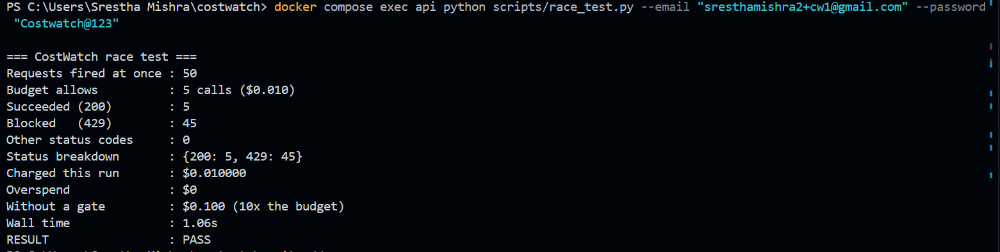

# CostWatch

**A budget firewall for LLM APIs: no user can spend past their monthly limit, even when 50 requests hit at the same moment.**

I built this as my capstone for the FlyRank AI Backend Engineering track. It reuses what I learned in the earlier assignments (FastAPI, Postgres in Docker, Supabase auth) and adds the part I hadn't done before: handling money correctly when many requests arrive at the same time.

## The problem

If you give people access to an LLM API with no limit, one bad loop or one user spamming requests can use up the whole month's budget before anyone notices. Checking the logs afterwards is too late, because the money is already spent. I wanted every request to be checked against the user's budget **before** the LLM is called, and blocked if there isn't enough left.

## What I claim, and how I proved it

| Claim | Evidence | Why it's true |
|---|---|---|
| **Zero overspend under concurrency.** 50 simultaneous requests against a budget for 5: exactly 5 pass, 45 are blocked, $0 over the limit | `scripts/race_test.py` (screenshot below), passes on every run | The budget check and the charge are **one atomic SQL `UPDATE`**, so Postgres's row lock stops two requests from spending the same money |
| **10x overspend prevented.** Without the gate, those 50 requests would spend $0.100 against a $0.010 budget | Same test (`Without a gate` line) | Simple arithmetic: 50 calls × $0.002. A bigger runaway loop would be blocked the same way, since the gate doesn't care how many requests arrive |
| **The LLM is never called once the budget is exhausted** | `429` responses, logged as `blocked` in the ledger with $0 cost | The gate runs **before** the LLM call in `app/main.py` |
| **Users are never charged for failed LLM calls** | Gemini returned 404 during development: every call returned `502 "You were not charged"`, and spend stayed at $0.00 | On any `LLMError`, the full reservation is refunded before returning |
| **Every request is auditable** | `GET /v1/usage/summary`, and the `token_ledger` table | Ok, blocked and failed requests are all written to an append-only ledger |
| **Auth no longer depends on Supabase per request** | Race test went from 7 failures to 0 after adding the cache | A 60-second token cache means only the first request with a token calls Supabase |

## What it does

- Users sign up and log in (Supabase), and every protected request needs a Bearer token
- Each user has a monthly budget in Postgres
- `POST /v1/chat/completions` checks the budget, calls the LLM, and charges the real cost
- If the budget is used up, the request gets `429` and the LLM is never called
- Every request (successful, blocked, or failed) is saved in a ledger table
- An admin can change any user's budget using a separate admin key

## Running it

You need Docker Desktop and a free Supabase project (with **Confirm email turned off** under Authentication, otherwise login fails until you click the email link).

```
cp .env.example .env
```

Fill in `SUPABASE_URL`, `SUPABASE_KEY` (the publishable key) and `ADMIN_API_KEY` (any long random string) in `.env`. Then:

```
docker compose up -d --build
```

Open http://localhost:8000/docs.

It runs in **mock mode** by default, so you don't need an LLM key to try it. Every mock call costs a fixed $0.002 and the default budget is $0.01.

### Quick demo

1. `POST /auth/signup`, then `POST /auth/login`. Copy the `access_token`.
2. Click **Authorize** and paste the token into HTTPBearer.
3. Call `POST /v1/chat/completions` with `{"prompt": "hello"}` five times. All return 200.
4. Call it a sixth time. You get `429 Monthly budget exceeded`.
5. `GET /v1/usage/summary` shows what you spent and the last 10 requests.

### Using real Gemini

Get a free key from Google AI Studio, then in `.env` set `LLM_MODE=gemini` and `GEMINI_API_KEY=...`, and run `docker compose up -d`.

## Endpoints

| Method | Path | Auth | What it does |
|---|---|---|---|
| GET | `/health` | none | Shows the app is up and which LLM mode it's in |
| POST | `/auth/signup` | none | Creates a user |
| POST | `/auth/login` | none | Returns an access token |
| GET | `/v1/me` | Bearer | Shows who you're logged in as |
| POST | `/v1/chat/completions` | Bearer | Sends a prompt through the budget check |
| GET | `/v1/usage/summary` | Bearer | Spent, remaining, last 10 requests |
| PUT | `/v1/budgets` | Admin key | Sets a user's monthly limit |

## Concepts used

| Concept | Where it is |
|---|---|
| API endpoints | `app/main.py` |
| Database (Postgres) | `app/db.py` (tables), `app/billing.py` (all queries) |
| Authentication | `app/auth.py` |
| LLM integration + cost log | `app/llm.py`, and the `token_ledger` table |
| Caching | token cache in `app/auth.py` |
| Swap: rate limiting / quotas | the budget check in `app/billing.py` |
| Swap: containerized stack | `Dockerfile`, `compose.yaml` |

## How the budget check works

Every chat request goes through four steps:

1. **Reserve.** Take the most this call could cost out of the budget. If there isn't enough, return 429.
2. **Call** the LLM.
3. **Settle.** Replace the reserved amount with the real cost and give back the difference. If the LLM fails, give back everything and return 502.
4. **Record** the request in the ledger.

The reserve step is one SQL statement:

```sql
UPDATE budgets
SET spent_usd = spent_usd + %s
WHERE user_id = %s AND spent_usd + %s <= monthly_limit_usd
RETURNING spent_usd, monthly_limit_usd
```

I did it this way because checking first (`SELECT`) and then updating would let two requests that arrive together both see "enough budget" and both spend it. With one `UPDATE`, Postgres locks the row, so the second request waits and then checks again against the new total. If no row comes back, the budget wasn't enough.

I reserve the *maximum* cost because you don't know what an LLM call costs until it finishes. It depends on how many tokens the model writes. I send `max_output_tokens` so the output can't go over that number, and then refund whatever wasn't used.

## Testing it under load

Clicking Execute in Swagger only sends one request at a time, so it can't show a race condition. I wrote `scripts/race_test.py` to send 50 requests at the same moment to a budget that only covers 5:

```
docker compose exec api python scripts/race_test.py --email you@example.com --password yourpassword
```

Result:



5 succeeded, 45 were blocked, and nothing was spent over the limit. Without the check, all 50 would have gone through, which is 10 times the budget.

The first time I ran this it **failed**: 5 succeeded and the budget was still exact (overspend $0), but 7 requests came back with other error codes. At that point every request was asking Supabase "whose token is this?" over the internet, 50 at once, so the most likely cause is Supabase rate-limiting those checks. I added a 60-second token cache so only the first request goes to Supabase, and the test has passed cleanly since.

## Configuration

All settings are in `.env` (see `.env.example`). The main ones:

- `LLM_MODE`: `mock` or `gemini`
- `DEFAULT_MONTHLY_LIMIT_USD`: budget for new users
- `MAX_OUTPUT_TOKENS`: limit sent to Gemini. Thinking models use part of this for reasoning, so 256 cut off answers for me; 1024 works
- `PRICE_INPUT_PER_M`, `PRICE_OUTPUT_PER_M`: price per million tokens. The free tier is actually $0, but I charge at the paid price so the budget means something

## Problems I ran into

- `gemini-2.5-flash` returned 404 because it's no longer available to new users. I only found this after adding a log line for LLM errors; before that I just saw a 502. I switched to `gemini-3.8-flash`.
- The first real answer was cut off. The model used almost all 256 output tokens on "thinking" before writing the answer, so I raised the cap to 1024.
- The race test failure described above (Supabase rate limit), fixed with the token cache.

## Honest limitations

- Budgets don't reset automatically each month yet. An admin has to change the limit.
- The token cache lives in the app's memory. With more than one API container, each would have its own cache. Also, a logged-out token could still work for up to 60 seconds.
- The prompt token count before the call is an estimate (characters ÷ 3, on purpose a bit high). For unusual text (for example lots of emoji or non-English scripts) the real count could be higher, and then a call could cost slightly more than was reserved. The race test proves zero overspend in mock mode, where the cost is fixed.
- Prices are set in `.env` and need to match the provider's current price list.
- There's no frontend; Swagger is the interface.
